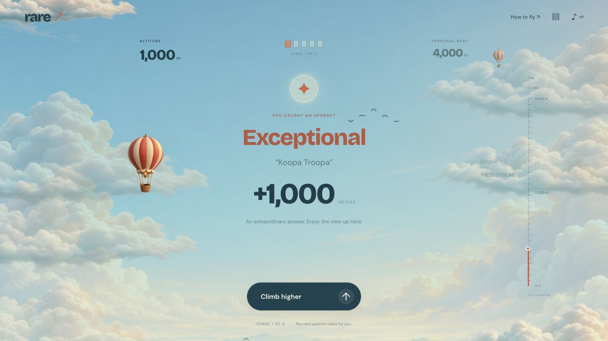

# RARE Air

A free daily trivia game where unexpected answers lift a hot-air balloon through an illustrated sky. Built with vanilla JavaScript, Canvas 2D, Cloudflare Workers and D1.

[Play RARE Air](https://krillionunlimited.top/)



Five questions, 30 seconds each, and up to 5,000 meters of altitude. Drag the balloon to steer, or focus it and use the arrow keys. Press Space or tap the balloon to catch a gust. Rare answers trigger wind rings, cloud breakthroughs and paper-plane companions.

The project includes hundreds of English question sets, accepted aliases, editorial rarity tiers, daily and practice modes, a date archive, anonymous daily leaderboards and browser-local flight history.

## Run locally

```sh
npm ci
npm run db:local
npm run dev
```

Open http://localhost:8787. No external API keys or AI service required.

## Verify

```sh
npm run check
npm test
# With local development server running:
node test/api.integration.mjs
```

The integration test creates local game records. Run against the local URL, not production. Test rules cover every alias, normalized spelling, scoring tiers, deterministic dates and absence of public answer keys.

## Deploy to the configured Cloudflare account

```sh
npm run db:remote
npm run deploy
```

For your own Cloudflare deployment, run `npx wrangler login` and `npx wrangler d1 create rare-daily-db`. Put the returned database ID into `wrangler.jsonc` and choose a Worker name for your account. Then run the two commands above to apply migrations and deploy.

The checked-in database ID identifies the live demo's resource. Cloudflare authentication is stored by Wrangler outside the repository. Local development uses a separate ignored database in `.wrangler/`.

## Game

- Five prompts per daily game, 30 seconds for each; daily reset at midnight UTC (08:00 China time).
- One attempt per browser per date. Practice gets a new random seed. Daily dates use a deterministic versioned shuffle.
- Curated answer bank: hundreds of question sets, accepted aliases, four rarity tiers worth 100, 250, 500 and 1,000 points. Invalid/skipped/expired answers get zero.
- Rarity is editorial, clearly explained in the game. It is not a population survey. Answers are stored in D1 so aggregate answer distributions can be analyzed later.
- Refreshing restores the current daily game. Elapsed time comes from the server. Leaving freezes no clock; an expired pending round is recorded when resumed and submitted, then the next round starts.
- Atomic D1 batches and unique round keys prevent duplicate scoring. Scores are derived server-side. Active sessions never expose their answer lists.
- Completed daily games appear under generated anonymous names on the top-20 leaderboard. Ties use game creation time.
- Browser-local daily statistics and a copyable spoiler-free scorecard; clipboard denial falls back to visible copyable text.

## Structure

- `src/worker.ts`: static assets, JSON API, origin checks, anonymous ownership, session clock, D1 records.
- `src/questions.js`: server-only question bank, answer normalization, scoring, puzzle schedule. Add prompts here; do not move this file into `public/`.
- `public/`: responsive frontend, animated flight world, locally hosted illustrations and fonts.
- `migrations/`: immutable ordered D1 schema migrations.
- `test/`: rule tests and real local Worker/D1 lifecycle tests.

## Content and operations

The bank contains 30 immutable legacy prompts, 270 expansion prompts, and dated daily batches of 100 new prompts. Practice uses the current bank, and each new daily pool starts on its release date. Dated packs are append-only and filtered by release date, so later packs cannot change old daily puzzles. Every new session stores exact question and scoring snapshots; pre-migration sessions retain the legacy bank. See `content/EDITORIAL.md` for content quality and publishing rules. Rarity is editorial, not a measured answer frequency.

Anonymous identity is per cookie, not a verified person. Clearing cookies creates another identity. No strong anti-bot control or global request quota is included; add Cloudflare rate limiting/Turnstile for larger public launches. The basic cap is 30 new sessions per browser per hour. No traffic-scale/load test or revenue claim is made.

D1 stores opaque player IDs, game state and chosen answers. No account emails or advertising IDs. Local storage holds stats. Production resources are separate from Wrangler's ignored local development database. Wrangler may use paid quotas according to the account plan.

To attach a domain, configure a Workers custom domain in Cloudflare Dashboard for `rare-daily`. Set `SITE_URL` to the owned HTTPS origin when running `npm run site:build` and `npm run mobile:sync`, then deploy the rebuilt website. This aligns canonical URLs, the sitemap, mobile API requests and native score sharing with that domain.

## Packaged mobile apps

The `ios/` and `android/` projects use Capacitor 8.6.2. They bundle the illustrated game, the question bank available at build time, local offline flight history, native score sharing, haptics, Android back navigation and network/lifecycle handling. Online daily flights and practice use the configured Cloudflare API. Offline scoring shares the server's normalization and answer evaluation functions.

```sh
npm ci
npm run mobile:sync
npx cap open ios
# Or open the Android project
npx cap open android
```

Android builds require JDK 21 and Android SDK 36. Release signing reads an external properties file through `RARE_ANDROID_SIGNING_PROPERTIES`. iOS distribution uses the Apple team configured in Xcode and a distribution provisioning profile. Build output and signing material stay outside Git. The public source includes app icons, store text, a Google Play feature graphic and captured platform screenshots.

See [mobile release preparation](release/README.md) for commands, verification, privacy details and remaining store steps.

## Daily 100-question task

Each new daily pack belongs in `content/packs/YYYY-MM-DD-daily.json` and must contain 100 distinct prompts with accepted answers, aliases, rarity tiers and source links. Follow [the editorial and publishing rules](content/EDITORIAL.md), run the bank build and checks, then deploy.

The demo's maintainer uses a local Codex automation at 07:00 Asia/Shanghai to prepare and publish these batches. You can configure a corresponding task for your own checkout. The computer and Codex app need to be running, and the task consumes Codex usage.

Use `npm run bank:build` to validate packs and regenerate server-only `src/bank.js`. Each daily pack must have exactly 100 prompts. Public `/api/puzzle` reports `bankSize` and `latestBatch` for deployment verification, without exposing answers.

## Flight interface

`public/sky.js` renders a continuous vertical flight world using Canvas 2D. A small hot-air balloon travels past cloud banks, birds, kites, other balloons and altitude landmarks. One server-scored point represents one game meter, up to 5,000 meters. The world moves downward with the camera during each ascent. Rarity tiers control distance, burner glow, wind rings, cloud sweeps, paper-plane formations, particle count and reward sound. Pointer dragging and focused arrow keys steer the balloon with spring motion. A tap or Space catches a visual gust.

The timed question and input controls sit directly in the scene. Every new prompt has a three-second preparation countdown. `/api/next` starts the server clock after that countdown. Reward screens wait for explicit continuation. The final flight report includes five stages, accepted answers, daily leaderboard and spoiler-free sharing. Anonymous session IDs and local history keys support previous games.

The visual module loads independently of the timed game. A still sky and direct altitude values remain available if the animation module fails. Reduced-motion preferences disable balloon, cloud, bird and particle movement. Rendering pauses in background tabs. The layout responds to the visual viewport when a mobile keyboard opens.

DM Sans and Bricolage Grotesque are hosted locally with their included SIL Open Font Licenses. The three game illustrations were generated with the built-in ImageGen tool and are stored at `public/art/dawn-sky.png`, `public/art/balloon.png` and `public/art/cloud-bank.png`. Image-generation prompts are recorded below. Runtime gameplay uses the local assets.

Search content at `/games-like-krillion/` describes the independent flight game. Canonical URLs, robots.txt and sitemap.xml use `https://krillionunlimited.top`. The custom domain uses Cloudflare-managed HTTPS and DNSSEC.

Additional crawlable pages cover daily trivia, playing rules, privacy and support. `npm run site:build` generates these pages, robots.txt and sitemap.xml. The homepage includes VideoGame structured data and social metadata. Runtime sky illustrations use compressed WebP files. The original PNGs remain in the source repository.

The mobile icon was generated with the built-in ImageGen tool using the existing balloon as a visual reference. `public/art/app-icon-source.png` preserves the generated source, and `public/art/app-icon.png` is the 1024-pixel export. Its prompt requested a polished square icon for RARE Air with a coral-and-ivory miniature hot-air balloon, a woven basket, sculptural ivory clouds, a pale turquoise dawn sky and warm sunrise lighting. It requested a readable silhouette at small sizes, refined tactile 3D materials, full-bleed artwork and a composition without lettering. Platform icon sizes are derived from that export.

### Illustration prompts

The sky prompt was used with an opaque background.

> Use case: stylized-concept. Asset type: full-bleed background for a premium daily flying trivia browser game. Create a beautiful cinematic stylized 3D painted sky landscape, a serene dawn above a sea of billowing sculptural ivory clouds, luminous pale blue turquoise sky at top two thirds, warm soft peach sunrise light from upper right. Low distant rolling blue-green mountain silhouettes peeking through cloud sea along bottom 15 percent. Several rich dimensional cumulus cloud banks frame lower left and lower right and tiny distant wisps at edges. Center and upper left kept spacious and quiet to place web game typography. Refined whimsical adventure videogame art with very subtle paper grain, miniature diorama quality, beautiful physically lit soft volumes, understated atmospheric perspective, high-end art direction. Landscape 1536x1024. No balloon, no aircraft, no people, no text, no lettering, no logos, no interface, no watermarks. Background should fill entire image to edges.

The balloon prompt was used with a transparent background.

> Use case: stylized-concept. Asset type: transparent hero sprite for a premium flying browser game. A single exquisitely crafted whimsical hot air balloon, classic teardrop silhouette with vertical alternating warm coral red and creamy ivory fabric gores, realistic subtle seams and fine cloth texture, elegant cream scalloped skirt at lower opening, four fine ropes connecting to a tiny richly detailed warm woven wicker basket with dark interior and brass rim. A small softly glowing burner flame inside throat. Rendered as premium miniature diorama art / refined 3D animation feature-film prop, beautiful diffused morning sunlight from upper right with soft shaded left side, tactile materials, crisp clean cutout edges, slightly elevated three-quarter camera view, balloon whole entirely in frame with generous transparent margin, upright vertical composition. No people, no face, no characters, no text, no lettering, no background, no clouds, no ground, no drop shadow on floor, genuine transparent alpha.

The cloud prompt was used with a transparent background.

> Use case: stylized-concept. Asset type: a transparent parallax cloud sprite for an illustrated hot-air-balloon browser game. A single long low cloud bank composed of beautiful sculptural billowing cumulus volumes, creamy ivory sunlit tops with pale blue teal shaded undersides, gentle warm peach sunlight from upper right, premium miniature diorama / 3D animation feature-film style, tactile fine cloud details and soft wispy outer edges. Wide horizontal composition, entire cloud fully contained with clear transparent margin, cloud centered, genuinely transparent alpha everywhere outside the cloud. No sky background, no landscape, no mountains, no objects, no text, no outlines, no floor shadow. The cloud should retain opaque rich volumes in its center and clean naturally feathered transparent edges.

## License

The code and original project material are available under the [MIT License](LICENSE). The locally hosted fonts retain their included SIL Open Font Licenses. The illustration prompts and generation provenance are documented above.

## WeChat game

The `wechat/` edition renders the illustrated game with native Canvas and WeChat keyboard, touch, sharing and storage APIs. It shares the answer evaluator and bundled offline question bank with the mobile apps. Online daily flights connect to the same Cloudflare API.

```sh
npm run wechat:build
```

Import `dist/wechat` as a game project in WeChat DevTools. See [WeChat setup and validation](wechat/README.md) for AppID, network-domain configuration and publication status.
